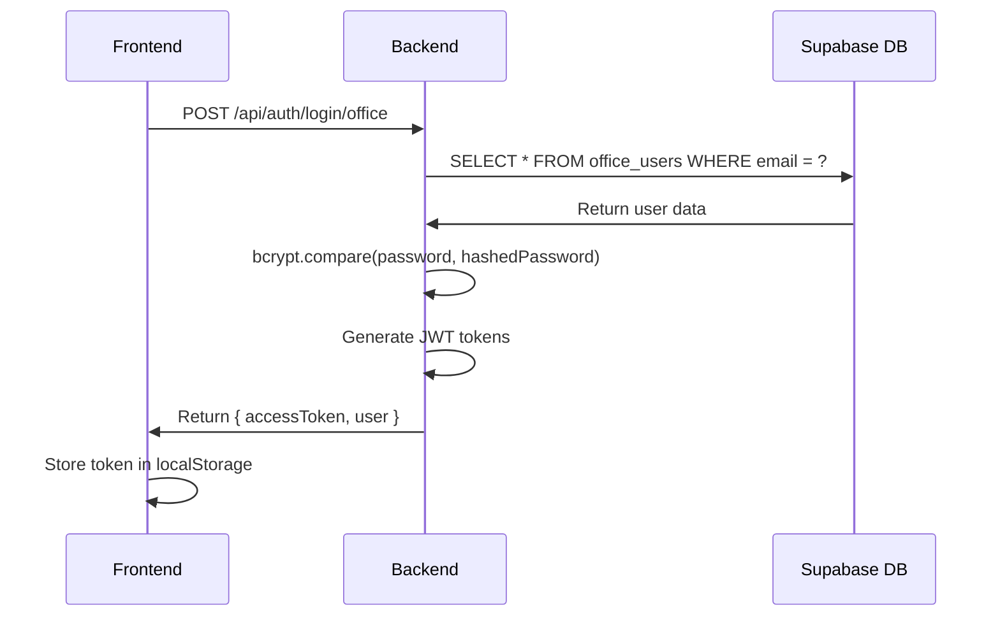
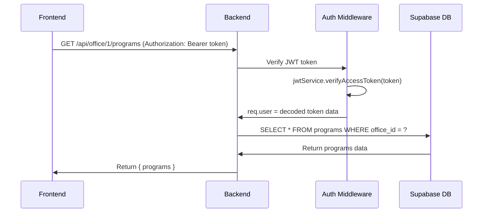
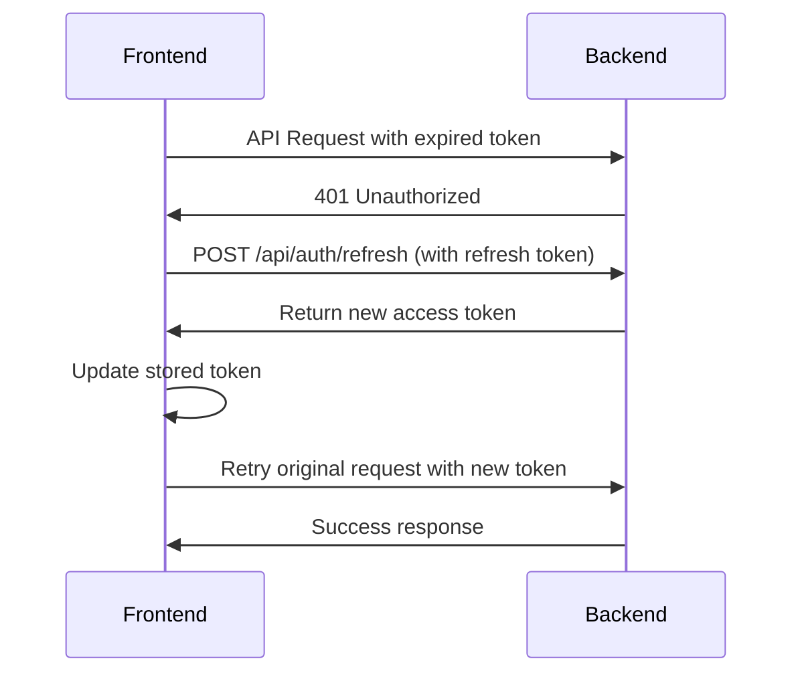

# 🏛️ ADZU Social Development Unit - Complete System Architecture

## 🎯 System Overview

The **ADZU Social Development Unit (SDU)** is a comprehensive web application built with a **client-server architecture** featuring:

- **Frontend**: React/Vite application (deployed on Vercel)
- **Backend**: Node.js/Express API server (deployed on Vercel)
- **Database**: Supabase PostgreSQL (cloud-hosted)
- **Authentication**: Professional JWT with access/refresh tokens
- **Architecture**: Clean separation between frontend, backend, and database

---

## 🏗️ Architecture Diagram

```
┌─────────────────┐    ┌─────────────────┐    ┌─────────────────┐
│   FRONTEND      │    │    BACKEND      │    │    DATABASE     │
│   (React/Vite)  │    │ (Node.js/Express)│    │   (Supabase)    │
│                 │    │                 │    │                 │
│ • User Interface│────│ • REST API      │────│ • PostgreSQL    │
│ • Authentication│    │ • JWT Handling  │    │ • Row Level     │
│ • State Mgmt    │    │ • Business Logic│    │   Security      │
│ • API Calls     │    │ • Database Calls│    │ • Real-time     │
│                 │    │                 │    │   Updates       │
└─────────────────┘    └─────────────────┘    └─────────────────┘
     Vercel                   Vercel               Supabase Cloud
```

---

## 🎭 User Types & Access Levels

### **1. Unit Director** 👔

- **Access**: Complete system overview
- **Permissions**: View all offices, all programs, manage users
- **Login**: `director@adzu.edu.ph` / `admin123`
- **Dashboard**: System-wide analytics and reports

### **2. Office Users** 🏢 (6 Offices)

- **Access**: Office-specific dashboard and data
- **Permissions**: Manage own office programs and users
- **Offices**:
  1. **SDO** - Social Development Office (`sdo@adzu.edu.ph` / `sdo123`)
  2. **CCES** - Center for Community Extension Services (`cces@adzu.edu.ph` / `cces123`)
  3. **API** - Ateneo Peace Institute (`api@adzu.edu.ph` / `api123`)
  4. **SACSI** - Social Awareness & Community Service (`sacsi@adzu.edu.ph` / `sacsi123`)
  5. **ACLG** - Ateneo Center for Leadership & Governance (`aclg@adzu.edu.ph` / `aclg123`)
  6. **ACCA** - Ateneo Center for Culture & Arts (`acca@adzu.edu.ph` / `acca123`)

---

## 🔐 Authentication System

### **JWT Token Architecture**

```javascript
// Access Token (15 minutes)
{
  "userId": "uuid",
  "email": "user@adzu.edu.ph",
  "userType": "office_user" | "unit_director",
  "name": "User Name",
  "office_id": 1, // null for unit directors
  "exp": 1234567890
}

// Refresh Token (7 days) - Stored securely
{
  "userId": "uuid",
  "userType": "office_user" | "unit_director",
  "tokenId": "refresh-uuid",
  "exp": 1234567890
}
```

### **Authentication Flow**

1. **Login Request** → Frontend sends credentials to `/api/auth/login/office` or `/api/auth/login/unit-director`
2. **Password Verification** → Backend verifies bcrypt hashed password
3. **JWT Generation** → Backend creates access + refresh tokens
4. **Token Storage** → Frontend stores access token in localStorage
5. **API Requests** → All requests include `Authorization: Bearer <token>` header
6. **Auto Refresh** → Frontend automatically refreshes expired tokens

---

## 📱 Frontend Architecture

### **Technology Stack**

- **Framework**: React 18 + Vite
- **Routing**: React Router v6
- **UI Library**: Material-UI (MUI)
- **State Management**: React Context + Local State
- **API Calls**: Native Fetch API with custom service layer
- **Authentication**: JWT-based with automatic refresh

### **Folder Structure**

```
frontend/src/
├── components/          # Reusable UI components
│   ├── Layout.jsx      # Main app layout
│   ├── Navbar.jsx      # Navigation bar
│   ├── Sidebar.jsx     # Navigation sidebar
│   ├── ProtectedRoute.jsx # Route protection
│   └── ...
├── context/            # React Context providers
│   └── AuthContext.jsx # Authentication state
├── hooks/              # Custom React hooks
│   ├── useApi.js       # API communication
│   └── useAuth.js      # Authentication helpers
├── pages/              # Page components
│   ├── Welcome/        # Landing page
│   ├── OfficeLogin/    # Office user login
│   ├── UnitDirectorLogin/ # Unit director login
│   ├── OfficeDashboard/ # Office-specific dashboard
│   └── UnitDirectorDashboard/ # Admin dashboard
├── services/           # API service layer
│   └── authService.js  # Authentication API calls
└── App.jsx             # Main application component
```

### **Key Components**

#### **AuthContext.jsx** - Authentication State Management

```javascript
// Provides authentication state across the app
const AuthContext = {
  user: null, // Current user object
  isAuthenticated: false, // Auth status
  loading: false, // Loading state
  login: async (email, password, userType) => {},
  logout: async () => {},
};
```

#### **authService.js** - API Communication

```javascript
// All authentication API calls
const AuthService = {
  loginOffice: async (email, password) => {
    const response = await fetch("/api/auth/login/office", {
      method: "POST",
      headers: { "Content-Type": "application/json" },
      body: JSON.stringify({ email, password }),
    });
    return response.json();
  },

  loginUnitDirector: async (email, password) => {},
  logout: async () => {},
  refreshToken: async () => {},
};
```

#### **ProtectedRoute.jsx** - Route Security

```javascript
// Protects routes based on authentication and role
<ProtectedRoute requiredRole="office_user">
  <OfficeDashboard />
</ProtectedRoute>
```

---

## 🖥️ Backend Architecture

### **Technology Stack**

- **Framework**: Node.js + Express.js
- **Database Client**: Supabase JavaScript Client
- **Authentication**: Custom JWT implementation
- **Password Hashing**: bcryptjs (12 salt rounds)
- **Security**: Helmet, CORS, Rate Limiting
- **Deployment**: Vercel Serverless Functions

### **Folder Structure**

```
backend/src/
├── controllers/         # Business logic
│   └── authController.js # Authentication logic
├── middleware/          # Express middleware
│   ├── auth.js         # JWT verification
│   └── rateLimiter.js  # Rate limiting
├── routes/             # API route definitions
│   ├── auth.js         # Authentication routes
│   ├── office.js       # Office-specific routes
│   ├── program.js      # Program management routes
│   └── unitDirector.js # Unit director routes
├── services/           # Business services
│   └── jwtService.js   # JWT token management
├── config/             # Configuration
│   └── database.js     # Supabase client setup
└── server.js           # Express server setup
```

### **API Endpoints**

#### **Authentication Routes** (`/api/auth/`)

```javascript
POST / api / auth / login / office; // Office user login
POST / api / auth / login / unit - director; // Unit director login
POST / api / auth / logout; // User logout
GET / api / auth / verify; // Token verification
POST / api / auth / refresh; // Token refresh
```

#### **Office Routes** (`/api/office/`)

```javascript
GET    /api/office/all                // Get all offices
GET    /api/office/:id/dashboard      // Office dashboard data
GET    /api/office/:id/programs       // Office programs
POST   /api/office/:id/programs       // Create program
PUT    /api/office/:id/programs/:pid  // Update program
DELETE /api/office/:id/programs/:pid  // Delete program
```

#### **Program Routes** (`/api/program/`)

```javascript
GET    /api/program/all               // All programs (unit director)
GET    /api/program/:id               // Specific program
POST   /api/program                   // Create program
PUT    /api/program/:id               // Update program
DELETE /api/program/:id               // Delete program
```

### **JWT Service** (`jwtService.js`)

```javascript
class JWTService {
  // Generate 15-minute access token
  generateAccessToken(payload) {
    return jwt.sign(payload, ACCESS_SECRET, { expiresIn: "15m" });
  }

  // Generate 7-day refresh token
  generateRefreshToken(userId, userType) {
    return jwt.sign({ userId, userType }, REFRESH_SECRET, { expiresIn: "7d" });
  }

  // Verify and decode tokens
  verifyAccessToken(token) {
    /* ... */
  }
  verifyRefreshToken(token) {
    /* ... */
  }
}
```

### **Authentication Controller** (`authController.js`)

```javascript
class AuthController {
  // Office user login
  static async loginOffice(req, res) {
    const { email, password } = req.body;

    // 1. Get user from database
    const { data: users } = await supabase
      .from("office_users")
      .select("*")
      .eq("email", email);

    // 2. Verify password with bcrypt
    const isValid = await bcrypt.compare(password, user.password);

    // 3. Generate JWT tokens
    const accessToken = jwtService.generateAccessToken({
      userId: user.id,
      email: user.email,
      userType: "office_user",
      name: user.name,
      office_id: user.office_id,
    });

    // 4. Return token and user data
    res.json({
      success: true,
      data: { accessToken, user },
    });
  }
}
```

---

## 🗃️ Database Architecture (Supabase PostgreSQL)

### **Core Tables**

#### **1. offices** - The 6 Ateneo Offices

```sql
CREATE TABLE offices (
  id UUID PRIMARY KEY DEFAULT gen_random_uuid(),
  name TEXT NOT NULL UNIQUE,        -- "Social Development Office"
  description TEXT,                 -- Office description
  created_at TIMESTAMP DEFAULT NOW(),
  updated_at TIMESTAMP DEFAULT NOW()
);
```

#### **2. office_users** - Staff Members

```sql
CREATE TABLE office_users (
  id UUID PRIMARY KEY DEFAULT gen_random_uuid(),
  office_id UUID REFERENCES offices(id),
  name TEXT NOT NULL,               -- "SDO Officer 1"
  email TEXT NOT NULL UNIQUE,       -- "sdo@adzu.edu.ph"
  password TEXT NOT NULL,           -- bcrypt hashed
  created_at TIMESTAMP DEFAULT NOW(),
  updated_at TIMESTAMP DEFAULT NOW()
);
```

#### **3. unit_directors** - System Administrators

```sql
CREATE TABLE unit_directors (
  id UUID PRIMARY KEY DEFAULT gen_random_uuid(),
  name TEXT NOT NULL,               -- "Dr. Maria Santos"
  email TEXT NOT NULL UNIQUE,       -- "director@adzu.edu.ph"
  password TEXT NOT NULL,           -- bcrypt hashed
  created_at TIMESTAMP DEFAULT NOW(),
  updated_at TIMESTAMP DEFAULT NOW()
);
```

#### **4. programs** - Office Programs/Projects

```sql
CREATE TABLE programs (
  id UUID PRIMARY KEY DEFAULT gen_random_uuid(),
  office_id UUID REFERENCES offices(id),
  title TEXT NOT NULL,              -- "Community Health Initiative"
  description TEXT,
  status TEXT CHECK (status IN ('upcoming', 'ongoing', 'completed', 'cancelled')),
  funding_source TEXT,              -- "University Fund", "External Grant"
  budget_allocated DECIMAL(10,2),
  start_date DATE,
  end_date DATE,
  program_heads TEXT[],             -- Array of program leaders
  sustainable_development_goals TEXT[], -- UN SDG alignment
  adzu_goals TEXT[],                -- ADZU institutional goals
  created_by UUID REFERENCES office_users(id),
  created_at TIMESTAMP DEFAULT NOW(),
  updated_at TIMESTAMP DEFAULT NOW()
);
```

### **Database Security**

- **Row Level Security (RLS)** enabled on all tables
- **Policies** ensure users can only access their office data
- **JWT verification** at database level
- **Encrypted connections** with SSL/TLS

### **Sample Data Structure**

```json
// Office User Session
{
  "user": {
    "id": "eca89fd1-234e-49d9-8da2-1c0b42a12b58",
    "name": "SDO User",
    "email": "sdo@adzu.edu.ph",
    "office_id": 1,
    "userType": "office_user"
  },
  "accessToken": "eyJhbGciOiJIUzI1NiIsInR5cCI6IkpXVCJ9..."
}

// Unit Director Session
{
  "user": {
    "id": "01111111-1111-1111-1111-111111111111",
    "name": "Dr. Maria Santos",
    "email": "director@adzu.edu.ph",
    "userType": "unit_director"
  },
  "accessToken": "eyJhbGciOiJIUzI1NiIsInR5cCI6IkpXVCJ9..."
}
```

---

## 🌐 Client-Server Communication Flow

### **1. User Login Flow**



### **2. Protected API Request Flow**



### **3. Auto Token Refresh Flow**



---

## 🚀 Deployment Architecture

### **Frontend Deployment (Vercel)**

```yaml
# vercel.json
{
  "framework": "vite",
  "buildCommand": "npm run build",
  "outputDirectory": "dist",
  "devCommand": "npm run dev",
  "installCommand": "npm install",
}
```

**Build Process**:

1. Code push to GitHub
2. Vercel auto-deploys from main branch
3. Environment variables configured in Vercel dashboard
4. Static assets served via Vercel CDN

### **Backend Deployment (Vercel Serverless)**

```yaml
# vercel.json
{
  "version": 2,
  "builds": [{ "src": "src/server.js", "use": "@vercel/node" }],
  "routes": [{ "src": "/(.*)", "dest": "src/server.js" }],
}
```

**Serverless Functions**:

- Each API endpoint becomes a serverless function
- Auto-scaling based on demand
- Cold start optimization
- Environment variables secured

### **Database (Supabase Cloud)**

- **Region**: Auto-selected for performance
- **Backups**: Automatic daily backups
- **SSL**: Enforced connections
- **Monitoring**: Built-in performance monitoring

---

## 🔧 Environment Variables

### **Frontend (.env)**

```bash
VITE_API_URL=https://your-backend.vercel.app
VITE_SUPABASE_URL=https://xxx.supabase.co
VITE_SUPABASE_ANON_KEY=eyJhbGciOiJIUzI1NiIsInR5cCI6...
```

### **Backend (.env)**

```bash
SUPABASE_URL=https://xxx.supabase.co
SUPABASE_ANON_KEY=eyJhbGciOiJIUzI1NiIsInR5cCI6...
JWT_ACCESS_SECRET=your-super-secure-access-secret-2024
JWT_REFRESH_SECRET=your-super-secure-refresh-secret-2024
CORS_ORIGIN=https://your-frontend.vercel.app
NODE_ENV=production
```

---

## 🛡️ Security Implementation

### **1. Authentication Security**

- **bcrypt** password hashing (12 salt rounds)
- **JWT** tokens with short expiration (15 minutes)
- **Refresh tokens** for seamless user experience
- **Rate limiting** (100 requests per 15 minutes)
- **CORS** protection for cross-origin requests

### **2. API Security**

```javascript
// Rate limiting middleware
const limiter = rateLimit({
  windowMs: 15 * 60 * 1000, // 15 minutes
  max: 100, // limit each IP to 100 requests per windowMs
});

// CORS configuration
const corsOptions = {
  origin: process.env.CORS_ORIGIN,
  credentials: true,
  optionsSuccessStatus: 200,
};

// Helmet for security headers
app.use(helmet());
```

### **3. Database Security**

- **Row Level Security** policies
- **Parameterized queries** prevent SQL injection
- **SSL/TLS** encrypted connections
- **Environment variables** for sensitive data

---

## 🧪 Testing & Development

### **Authentication Testing**

Use the `/frontend/auth-test.html` file to test all authentication flows:

1. **Unit Director Login**: `director@adzu.edu.ph` / `admin123`
2. **Office Logins**:
   - SDO: `sdo@adzu.edu.ph` / `sdo123`
   - CCES: `cces@adzu.edu.ph` / `cces123`
   - API: `api@adzu.edu.ph` / `api123`
   - SACSI: `sacsi@adzu.edu.ph` / `sacsi123`
   - ACLG: `aclg@adzu.edu.ph` / `aclg123`
   - ACCA: `acca@adzu.edu.ph` / `acca123`

### **API Testing**

```bash
# Test API health
curl https://your-backend.vercel.app/api/health

# Test office login
curl -X POST https://your-backend.vercel.app/api/auth/login/office \
  -H "Content-Type: application/json" \
  -d '{"email": "sdo@adzu.edu.ph", "password": "sdo123"}'

# Test protected route
curl -X GET https://your-backend.vercel.app/api/office/1/programs \
  -H "Authorization: Bearer YOUR_ACCESS_TOKEN"
```

---

## 📈 Performance Optimization

### **Frontend Optimizations**

- **Code splitting** with React.lazy()
- **Bundle analysis** with Vite build tools
- **Image optimization** with modern formats
- **Caching strategies** for static assets

### **Backend Optimizations**

- **Connection pooling** for database
- **Query optimization** with indexes
- **Caching** for frequently accessed data
- **Serverless cold start** minimization

### **Database Optimizations**

- **Indexes** on frequently queried columns
- **Query performance** monitoring
- **Connection pooling** for concurrent requests
- **Read replicas** for scaling (if needed)

---

## 🔮 Future Enhancements

### **Planned Features**

1. **Real-time Notifications** - WebSocket implementation
2. **File Upload System** - Document management
3. **Advanced Reporting** - Charts and analytics
4. **Mobile App** - React Native implementation
5. **Audit Logging** - Complete action tracking
6. **Email Integration** - Automated notifications

### **Scaling Considerations**

- **Redis** for session management at scale
- **CDN** for static asset distribution
- **Load balancing** for high traffic
- **Microservices** architecture for complex features

---

## 📞 System Endpoints Summary

### **Frontend URLs**

- **Production**: `https://your-frontend.vercel.app`
- **Development**: `http://localhost:5173`

### **Backend URLs**

- **Production**: `https://your-backend.vercel.app`
- **Development**: `http://localhost:5001`

### **Database**

- **Supabase**: `https://xxx.supabase.co`
- **Dashboard**: Supabase web interface

---

This architecture provides a **scalable**, **secure**, and **maintainable** solution for the ADZU Social Development Unit management system with clear separation of concerns and professional-grade implementation.
